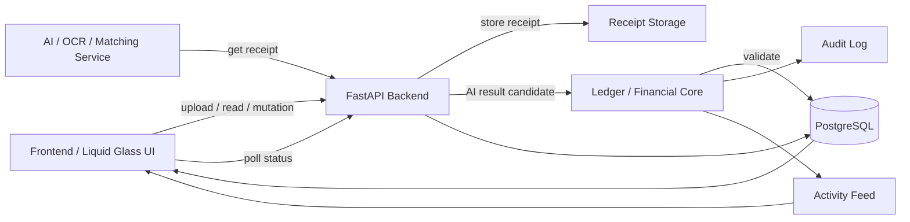

# Kiến trúc trực quan

## Nguyên tắc

`AI -> Backend validation -> DB transaction/uniqueness -> Ledger -> Activity/UI`

Không có đường:

`AI -> Balance`

hoặc:

`Frontend -> new_balance`

## Phần dễ thay thế

- AI có thể đổi OCR model/provider mà không đổi ledger.
- Frontend có thể đổi React/Vue/Next.js mà không đổi financial rules.
- Storage có thể đổi local → S3/Cloudflare R2 mà không đổi API contract chính.
- Queue có thể thêm Celery/RQ/Redis sau Phase 5.
