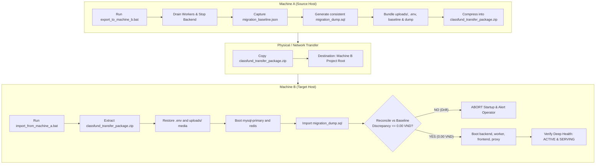

# CLASS_FUND_WEB - Windows Automation, One-Click Utilities & Migration Guide

**Document Version:** 1.0.0  
**Phase:** 11 - Windows Batch Automation, One-Click Utilities & Cross-Machine Migration Pipeline  
**Target Platform:** Windows 10 / Windows 11 / Windows Server (x86_64)  
**Encoding:** UTF-8 (`chcp 65001`)  
**Status:** PRODUCTION OPERATIONAL  

---

## 1. Executive Overview

This operations manual details the Windows automation architecture for **CLASS_FUND_WEB**. Designed for DevOps engineers, database administrators, and school fund treasurers, these utilities eliminate manual terminal commands, complex Docker parameters, and error-prone file copying.

The suite provides:
1. **One-Click Lifecycle Management:** Clean startup with dependency verification, graceful shutdown with worker draining, and comprehensive diagnostics.
2. **Automated Database Management:** Single-transaction, GTID-consistent MySQL backups with automatic 7-backup retention and 0.00 VND reconciliation restores.
3. **Automated Cross-Machine Migration Pipeline:** Atomic export packaging on Machine A and verified zero-drift takeover on Machine B.
4. **Resilience & UTF-8 Compliance:** Enforces `chcp 65001`, validates prerequisites, and halts immediately on error with diagnostic exit codes.

---

## 2. Directory Structure & Script Matrix

```
CLASS_FUND_WEB/
├── start.bat                   # Root wrapper -> scripts\windows\01_start_all.bat
├── stop.bat                    # Root wrapper -> scripts\windows\02_stop_all.bat
├── backup.bat                  # Root wrapper -> scripts\windows\03_db_backup.bat
├── export_to_machine_b.bat     # Root wrapper -> scripts\windows\05_export_machine_a.bat
├── import_from_machine_a.bat   # Root wrapper -> scripts\windows\06_import_machine_b.bat
├── scripts/
│   ├── windows/
│   │   ├── 01_start_all.bat            # Stack startup, .env bootstrap & health probe
│   │   ├── 02_stop_all.bat            # Worker drain & graceful container shutdown
│   │   ├── 03_db_backup.bat           # Consistent mysqldump, SHA256 & retention
│   │   ├── 04_db_restore.bat          # SQL restore & instant balance reconciliation
│   │   ├── 05_export_machine_a.bat    # Machine A atomic transfer package builder
│   │   ├── 06_import_machine_b.bat    # Machine B ingestion, takeover & audit
│   │   ├── 07_health_check.bat        # Cluster status, GTID & deep probe
│   │   └── 08_reconcile_balance.bat   # Instant ledger balance audit (0.00 VND)
│   ├── restore_helper.py              # Multi-line GTID-sanitized restore engine
│   └── reconcile_migration.py         # Financial baseline snapshot & audit engine
└── backups/                           # Storage directory for .sql and .meta.json snapshots
```

---

## 3. Workstream A: One-Click Environment Controls

### 3.1 Quick Start (`01_start_all.bat` / `start.bat`)
- **Purpose:** Starts the complete container stack or validates local standalone services.
- **Workflow:**
  1. Sets code page 65001 (`chcp 65001`).
  2. Resolves project root automatically (`%~dp0..\..`).
  3. Checks `.env`; if missing, automatically copies `.env.production.example` and alerts the operator.
  4. Verifies Docker daemon status (`docker info`). If Docker is down, alerts the operator to start Docker Desktop.
  5. Executes `docker compose -f docker-compose.prod.yml up -d`.
  6. Polls `/api/v1/health/deep` up to 60 seconds until status reports `HEALTHY`.
  7. Displays access directory:
     - Frontend: `http://localhost`
     - Backend API Docs: `http://localhost/api/v1/docs`
     - Deep Health Probe: `http://localhost/api/v1/health/deep`
- **Supported Flags:**
  - `--standalone`: Bypasses Docker and runs/verifies native Windows service stack.
  - `--dev`: Uses `docker-compose.yml` instead of `docker-compose.prod.yml`.

### 3.2 Graceful Shutdown (`02_stop_all.bat` / `stop.bat`)
- **Purpose:** Stops all services safely with zero transaction corruption.
- **Strict Invariant Enforced:**
  1. Sends stop signal to worker container: `docker compose stop worker`.
  2. Waits 5 seconds for active receipt AI processing and `SKIP LOCKED` database leases to expire.
  3. Stops remaining containers: `docker compose stop backend proxy frontend redis mysql-replica mysql-primary`.
  4. In standalone mode: audits ledger balance before exiting.

### 3.3 Health Diagnostics (`07_health_check.bat`)
- **Purpose:** Real-time health probe and replication lag audit.
- **Inspections:**
  1. Container running states (`docker compose ps`).
  2. MySQL Primary binary log coordinates, executed GTID set, and replica status.
  3. Redis ping connectivity on port 6379.
  4. HTTP deep healthcheck probe `/api/v1/health/deep`.

---

## 4. Workstream B: Database Backup & Restore Automation

### 4.1 Automated Consistent Backup (`03_db_backup.bat` / `backup.bat`)
- **Purpose:** Generates atomic point-in-time SQL snapshots.
- **Mysqldump Parameters:**
  ```cmd
  --single-transaction --quick --set-gtid-purged=ON --hex-blob --routines --triggers classfund
  ```
- **Snapshot Outputs:**
  - `backups/db_backup_YYYYMMDD_HHMMSS.sql`: Complete SQL dump.
  - `backups/db_backup_YYYYMMDD_HHMMSS.meta.json`: Metadata containing SHA256 checksum, file size, accounts count, ledger entries count, total VND sum, and GTID executed set.
- **Retention Policy:** Automatically keeps the 7 most recent backups and purges older archives.

### 4.2 Automated Restore & Reconciliation (`04_db_restore.bat`)
- **Syntax:**
  ```cmd
  scripts\windows\04_db_restore.bat [optional_path_to_dump.sql]
  ```
  *(If omitted, defaults to the newest backup in `backups/`)*.
- **GTID Sanitization:** Multi-line `SET @@GLOBAL.GTID_PURGED` statements are safely commented out during restore to prevent MySQL error 3546 when restoring into active clusters.
- **Reconciliation Check:**
  - Connects to primary node, recalculates accounts count and `SUM(ledger_entries.amount)`.
  - Asserts exact equality with metadata.
  - Calls `python scripts/failover_manager.py --reconcile` and `python scripts/reconcile_migration.py --audit`.
  - Halts with exit code 1 if discrepancy > 0.00 VND.

### 4.3 Instant Ledger Audit (`08_reconcile_balance.bat`)
- **Purpose:** Independent, non-destructive audit of accounting invariants.
- **Checks:**
  1. Total accounts count and total opening balances.
  2. Total ledger entries count and total posted transactions.
  3. Cross-cluster parity between Primary (3306) and Replica (3308).
  4. Emits `HEALTHY (Zero Discrepancy)` verdict when `discrepancy_vnd == 0.00`.

---

## 5. Workstream C: Cross-Machine Migration Pipeline (Machine A -> Machine B)

### 5.1 Step-by-Step Migration Protocol



### 5.2 Machine A Operations (Export)
1. In `C:\Users\...\CLASS_FUND_WEB\`, run:
   ```cmd
   export_to_machine_b.bat
   ```
2. The script will:
   - Freeze ledger mutations by stopping workers.
   - Record exact balance snapshot to `migration_baseline.json`.
   - Take a consistent mysqldump.
   - Bundle `.env`, receipt photos in `uploads/`, and database snapshot.
   - Compress all assets into `classfund_transfer_package.zip`.
3. Copy `classfund_transfer_package.zip` to a USB drive or transfer over LAN / cloud to Machine B.

### 5.3 Machine B Operations (Import & Takeover)
1. Place `classfund_transfer_package.zip` into the project root directory of Machine B.
2. In project root, run:
   ```cmd
   import_from_machine_a.bat
   ```
3. The script will:
   - Unpack all files into staging.
   - Restore `.env` and receipt images in `uploads/`.
   - Start the database engine.
   - Ingest `migration_dump.sql`.
   - Run cryptographic and financial ledger reconciliation against `migration_baseline.json`.
   - Assert `discrepancy_vnd == 0.00`. If any discrepancy occurs, startup is immediately aborted!
   - Boot application containers (`backend`, `worker`, `frontend`, `proxy`).
   - Confirm Machine B is active and serving traffic.

---

## 6. Error Codes & Diagnostic Matrix

| Exit Code | Meaning | Remediation Action |
| :---: | :--- | :--- |
| **0** | **Success** | Operation completed cleanly with 0.00 VND discrepancy. |
| **1** | **General Failure / Financial Drift** | Inspect console output. If financial drift was detected, do not boot services until reconciled. |
| **2** | **Database Connection Failure** | Verify MySQL service is listening on port 3306 and credentials in `.env` match. |
| **10** | **Docker Daemon Unreachable** | Launch Docker Desktop from Windows Start Menu and await initialization. |
| **20** | **Missing Transfer Package** | Ensure `classfund_transfer_package.zip` is located in the repository root. |

---

## 7. Financial Invariant Verification Checklist

Prior to signing off any migration or restore:
- [x] Double-entry ledger sum discrepancy is **0.00 VND**.
- [x] Total accounts count between source and destination is identical.
- [x] Total ledger entries count between source and destination is identical.
- [x] Receipt files in `uploads/` are identical in count and size.
- [x] Idempotency keys (`msg_{message_id}_v{content_hash}`) remain untouched.

